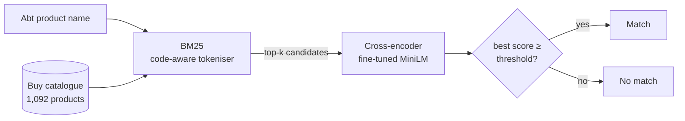

# retrieve-then-match

Two-stage text entity matching on the **Abt-Buy** product benchmark: a BM25 retriever proposes candidates, and a cross-encoder decides which candidate (if any) is the same product.

The project is built around evaluation rather than any single model. Every claim below comes from paired significance tests, every number is reproducible from one script, and the final results come from a held-out test split that was used once, after the hypotheses were [pre-registered](docs/preregistration.md).

## Results

Final results on the held-out test split (433 queries, used once):

| System | hit@1 | MRR@20 | Precision | Recall | F1 |
|---|---|---|---|---|---|
| BM25, simple tokeniser | 0.658 | 0.766 | | | |
| BM25, code-aware tokeniser | 0.829 | 0.896 | | | |
| BM25, tuned (code-aware, name-only queries) | 0.903 | 0.939 | 0.902 | 0.872 | 0.887 |
| Dense retrieval (BGE-small) | 0.818 | 0.886 | | | |
| Hybrid (BM25 + dense, RRF) | 0.891 | 0.933 | | | |
| BM25 → zero-shot cross-encoder | 0.815 | 0.886 | 0.815 | 0.791 | 0.803 |
| **BM25 → fine-tuned cross-encoder** | **0.938** | **0.965** | **0.940** | **0.910** | **0.925** |
| BM25 → fine-tuned cross-encoder, 5 candidates | 0.938 | 0.961 | 0.940 | 0.910 | 0.925 |

Precision, recall and F1 are pair-level and end-to-end: a true match the retriever never proposed counts as a miss. They are reported for the matching pipelines; the retrieval-only rows are ranking results.

### Pre-registered findings

Paired tests on per-query outcomes: exact McNemar for hit@1, sign-flip permutation for MRR, bootstrap 95% confidence intervals, Holm correction across the metrics within each comparison.

| | Comparison | hit@1 change (95% CI) | Queries won / lost | Holm p (hit@1) | Verdict |
|---|---|---|---|---|---|
| H1 (primary) | BM25 matcher → fine-tuned cross-encoder | +3.5 pts [+0.7, +6.5] | 28 / 13 | 0.110 | **Not confirmed** at α = 0.05 (MRR +2.6 pts, Holm p = 0.020) |
| H2 | Zero-shot → fine-tuned cross-encoder | +12.2 pts [+8.8, +15.7] | 57 / 4 | < 0.0001 | Confirmed |
| H3 | Simple → code-aware tokeniser | +17.1 pts [+13.2, +21.0] | 81 / 7 | < 0.0001 | Confirmed |
| H4 | Tuned BM25 → dense (BGE-small) | −8.5 pts [−12.2, −4.8] | 16 / 53 | < 0.0001 | BM25 significantly better |
| H5 | Tuned BM25 → hybrid RRF | −1.2 pts [−3.2, +0.9] | 8 / 13 | 1.0 | No detectable difference |
| H6 | Fine-tuned, 20 → 5 candidates | 0.0 pts [−0.9, +0.9] | 2 / 2 | 1.0 | No detectable difference |

What this means:

1. **Tokenisation is the biggest single lever.** Product matching hinges on model numbers (`MDR-J10` vs `MDRJ10/BLUE`, `161WH` vs `161`). A tokeniser that joins hyphenated codes and splits letter/digit runs lifts BM25 hit@1 by 17 points.
2. **Well-tuned BM25 is a hard baseline.** It significantly beats a small dense retriever and fusing the two adds nothing measurable, at a fraction of the latency.
3. **A zero-shot cross-encoder hurts; fine-tuning fixes it.** The MS MARCO cross-encoder was trained to judge whether a passage answers a search query, not whether two listings describe the same product, and it ranks worse than BM25 alone. About a minute of fine-tuning on 432 training queries with BM25 hard negatives turns it into the strongest system (+12.2 points hit@1 over zero-shot).
4. **The fine-tuned model is the best system, but its hit@1 gain over BM25 is not significant under the pre-registered test.** It wins on every metric and significantly improves MRR, but the primary test (hit@1, Holm-corrected) gives p = 0.110. The result is reported as pre-registered.
5. **Five candidates are enough.** The fine-tuned matcher reaches the same accuracy from BM25's top 5 as from its top 20, with a quarter of the cross-encoder work.

### Validation and test agree

Every system kept the same ordering from validation (216 queries) to test (433 queries):

| System | Validation hit@1 | Test hit@1 |
|---|---|---|
| Tuned BM25 | 0.870 | 0.903 |
| Dense (BGE-small) | 0.787 | 0.818 |
| Hybrid RRF | 0.870 | 0.891 |
| Zero-shot cross-encoder | 0.796 | 0.815 |
| Fine-tuned cross-encoder | 0.917 | 0.938 |

## How it works



**Data.** Abt-Buy, from the Leipzig entity-resolution benchmarks (Köpcke, Thor & Rahm, 2010), downloaded by `rtm download`: 1,081 Abt products, 1,092 Buy products and 1,097 gold matching pairs; 16 Abt products have more than one match. Each Abt product is a query; the system searches all of Buy. The two sides look very different: Abt names are long and repetitive, Buy entries are short and sometimes noisy ("Boss" for "Bose").

**Retrieval.** BM25 is implemented from scratch over an inverted index, so the tokeniser is fully under control. The code-aware tokeniser emits normal tokens plus joined codes (`MDR-J10` → `mdrj10`) and letter/digit pieces (`161WH` → `161`, `wh`). Dense retrieval uses [BGE-small-en-v1.5](https://huggingface.co/BAAI/bge-small-en-v1.5) with exact cosine search. The hybrid fuses both rankings with Reciprocal Rank Fusion (Cormack et al., 2009).

**Matching.** A cross-encoder scores each (query, candidate) pair and reranks the candidates. Under the `top1` policy, a query's best candidate is a match if its score clears a threshold. The threshold is tuned on validation to maximise F1, then frozen.

**Fine-tuning.** The [MS MARCO MiniLM cross-encoder](https://huggingface.co/cross-encoder/ms-marco-MiniLM-L-6-v2) is fine-tuned on the train split only: each query's gold match is a positive, and BM25's four highest-ranked *wrong* candidates are hard negatives (same brand, similar model number, different product). 2,163 pairs, 3 epochs, binary cross-entropy, AdamW with linear warmup, in a plain seeded PyTorch loop. Training took 61 seconds on an Apple Silicon GPU (MPS).

## Evaluation protocol

- **Splits.** Queries are split 40 / 20 / 40 into train, validation and test (seed 42), stratified on whether a query has a match.
- **Validation decides, test reports.** Every setting (tokeniser, fields, candidate depth, threshold) was chosen on validation. The test split was run once, by [`scripts/final_test.sh`](scripts/final_test.sh), after the hypotheses were committed in [`docs/preregistration.md`](docs/preregistration.md). The script refuses to run with uncommitted changes, so results map to exactly one commit.
- **Paired significance tests.** Systems are compared on the same queries: exact McNemar tests on per-query hits, sign-flip permutation tests on reciprocal rank, bootstrap confidence intervals, Holm correction. Several apparent gains of 1 to 2 points during development (for example, adding the manufacturer field) did not survive these tests and are not claimed.
- **Traceability.** Every run writes a report with the full config, a config fingerprint, the git commit, environment details and per-query rankings.

## Reproduce

Requires [uv](https://docs.astral.sh/uv/).

```bash
git clone https://github.com/xquantize/retrieve-then-match
cd retrieve-then-match
uv sync
uv run rtm download        # fetch Abt-Buy into data/raw/
uv run rtm inspect         # dataset statistics and example matches

scripts/reproduce.sh       # every validation experiment, training, and paired comparisons
scripts/final_test.sh      # the held-out test evaluation (needs a clean git tree)
```

Each script writes its runs and a full log into a fresh folder under `runs/`. BM25 results are exactly deterministic; model-based results can vary very slightly between hardware backends.

### Command-line reference

| Command | What it does |
|---|---|
| `rtm download` | Download and extract the dataset |
| `rtm inspect` | Dataset statistics and a few gold pairs |
| `rtm retrieve -m bm25\|dense\|hybrid` | Evaluate a retriever (recall@k, hit@k, MRR, latency) |
| `rtm train` | Fine-tune the cross-encoder on the train split |
| `rtm match` | Retrieve, rerank and decide matches (precision, recall, F1) |
| `rtm runs` | List saved runs |
| `rtm compare A B` | Paired significance test of run B against run A |

Any config value can be overridden for an experiment, e.g. `--set retrieval.bm25.tokenizer=simple` or `--set matching.candidate_k=5`. Overrides are validated and change the run's config fingerprint.

## Limitations

- **One small benchmark.** Abt-Buy is a single dataset of about 1,100 products, and the conclusions may not transfer to other domains or larger catalogues.
- **Every query has a match.** All Abt products have at least one true match, so rejecting a query can only cost recall. Top-1 F1 is therefore close to reranked hit@1, and the threshold matters little here. Datasets with unmatchable records would test it properly.
- **Single seed.** The split and the fine-tuning run use one seed. Variation across seeds has not been measured.
- **Limited statistical power.** With 216 validation and 433 test queries, effects of 1 to 2 points are not detectable, and the primary hypothesis (H1) fell short of significance under its pre-registered correction.
- **Multiple comparisons.** Holm correction is applied across the metrics within each comparison, not across all six comparisons.
- **Small models only.** BGE-small and MiniLM-L6 were chosen to run on a laptop. Larger models may change the dense and cross-encoder results.

## Licence and credits

Code under the MIT licence. Abt-Buy dataset from the Leipzig entity-resolution benchmarks (H. Köpcke, A. Thor, E. Rahm, *Evaluation of entity resolution approaches on real-world match problems*, PVLDB 2010). Models: BAAI BGE-small-en-v1.5 and the sentence-transformers MS MARCO MiniLM cross-encoder.
